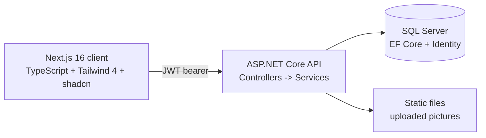

# Raidite

A Reddit-style community platform built with **ASP.NET Core** (backend) and **Next.js 16** (client).

> [](https://dotnet.microsoft.com/) [](https://nextjs.org/) [](https://react.dev/) [](https://www.microsoft.com/sql-server) [](https://tailwindcss.com/)

> [`README-fr`](#-aperçu-de-lapplication) — English below.

## Overview

Raidite is a community discussion platform where communities are called **Hubs** (the equivalent of "subreddits"). It supports full user accounts, posting with multi-image galleries, threaded commenting, saving, per-hub feeds, and server-side search & sorting.

- Full authentication using **ASP.NET Identity** with **JWT** token issuance/validation (issuer, audience and signature validated on the server; the client sends the bearer token through a custom Axios interceptor)
- Posts support **multiple image uploads** (multipart/form-data) handled by a dedicated picture service
- Comments are stored as a tree: the post title text itself is the root comment, replies are nested — one unified comment model powers both feed and reply views
- Server-side search matching on hub/post titles, two sorting modes available for posts and comments
- Swagger UI is enabled in development to explore the `api/{controller}/{action}` routes

## Architecture



```text
├─ RaiditeServer/        # .NET API
│  ├─ Controllers/       # Posts, Comments, Users, Hubs
│  ├─ Services/          # HubService, PostService, CommentService, PictureService
│  ├─ Models/ + DTOs/    # EF entities and display projections
│  └─ Migrations/        # Code-first schema history
└─ raidite-client/       # Next.js 16 App Router client
   └─ app/               # Route groups, dynamic [id] pages, per-entity hooks under app/_hooks
```

## API surface highlights

| Group            | Capabilities                                                        |
|------------------|---------------------------------------------------------------------|
| `Posts`          | create (with images), per-hub and per-feed feeds, search + sort, full post view, save/unsave |
| `Comments`       | add reply, upvote/downvote, delete; sorting by score or recent       |
| `Hubs`           | create hub, view hub, follow/unfollow, get joined hubs               |
| `Users`/Account  | register, login (JWT issued), profile, avatar                        |

The complete list is browsable in Swagger (`/swagger`) when the server runs in development.

## Getting started

### Prerequisites

- .NET SDK (8/9) — check `RaiditeServer.csproj` for the target framework
- Node.js ≥ 20 for the Next.js client
- A SQL Server instance — LocalDB works out of the box on Windows

### Backend

```sh
cd RaiditeServer
dotnet restore
dotnet ef database update   # applies migrations to LocalDB
dotnet run                  # https://localhost:7127 (see launchSettings.json)
# Swagger: https://localhost:7127/swagger
```

The JWT signing key, issuer and audience are configured in `RaiditeServer/Program.cs`.
For a production deployment, load the secret key from environment/user-secrets instead.

### Client

```sh
cd raidite-client
npm install
npm run dev    # http://localhost:3000
```

The API domain is set in `raidite-client/next.config.ts` (`apiDomain`) — point it at your backend URL.

## Screenshots

<!-- TODO: drop screenshots into docs/ and reference:


-->

## Built as a term project for a college-level .NET/React web development course (2026). All code by [ArtXDan](https://github.com/ArtXDan).
